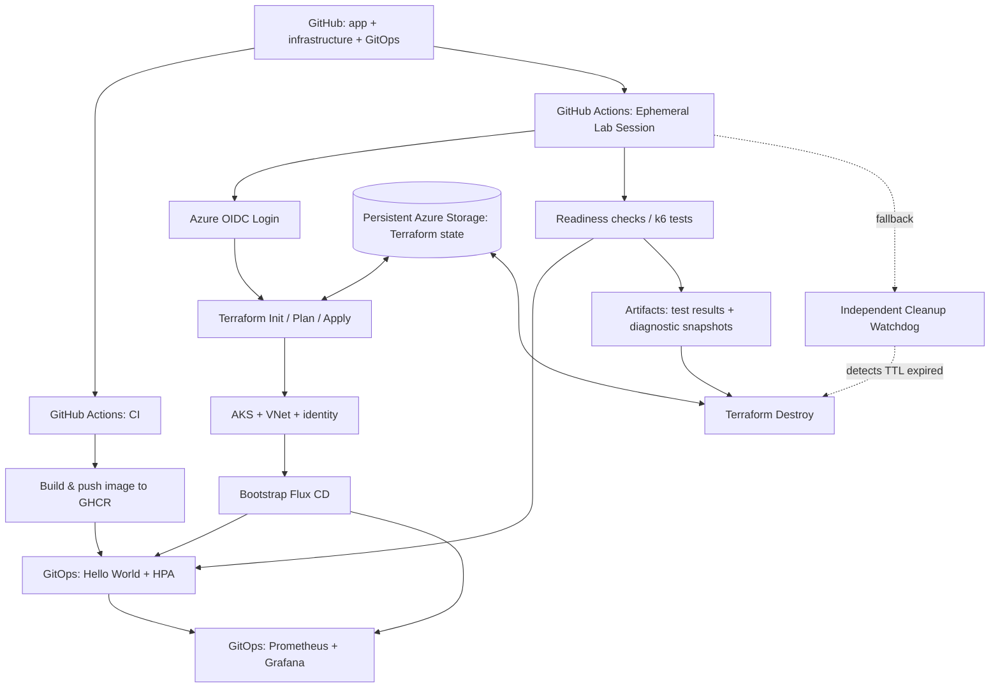

# Ephemeral DevOps Performance Lab

**Формат:** учебное техническое задание + пошаговый roadmap  
**Статус:** CI и минимальный Terraform AKS реализованы; полный lifecycle и GitOps остаются планом

**Основной принцип:** `deploy → verify → experiment → collect → destroy`  
**Продолжительность одной сессии:** 60–120 минут  
**Обновлено:** 31 октября 2026

## 1. Цель

Создать полностью автоматизируемую временную лабораторию на Azure, в которой можно:

1. Одной командой или запуском GitHub Actions поднять тестовую инфраструктуру.
2. Собрать Hello World приложение как Docker image, опубликовать его в GHCR.
3. Развернуть приложение через **GitOps / Flux CD**, а не через `kubectl apply` в release pipeline.
4. Собрать метрики в **Prometheus**, просмотреть их в **Grafana**.
5. Проверить **HPA** под небольшой, но реальной нагрузкой (CPU requests в миллиядрах, несколько Pod на одном/нескольких Node).
6. Провести controlled experiments: обычная нагрузка, увеличение RPS, CPU throttling, OOMKilled, проблемы scheduling.
7. Сохранить отчёт и логи **до удаления** кластера.
8. Автоматически удалить все временные ресурсы Terraform, включая ресурсы, созданные для экспериментов.

**Не цель:** production-scale стресс-тест на десятки CPU, разработка сложного backend, круглосуточная работа кластера.

### Стек

| Область | Технология |
|---|---|
| Infrastructure as Code | Terraform + AzureRM Provider |
| Cloud / Kubernetes | Azure, AKS |
| CI/CD и orchestration | GitHub Actions |
| Containers | Docker, GHCR (public packages для простоты) |
| GitOps | Flux CD + Kustomize + HelmRelease |
| Monitoring | Prometheus, Grafana, kube-state-metrics, node-exporter |
| Autoscaling | Metrics Server, HPA по CPU (далее custom metrics) |
| Load testing | k6 (в GitHub runner или в пределах кластера, с жёсткими ограничениями) |
| Security | GitHub OIDC → Azure federated credentials; Azure RBAC |

## 2. Архитектура



**Постоянная часть (создаётся один раз):**

- GitHub repo + GitHub Actions environment/permissions.
- OIDC identity и federated credential для GitHub Actions.
- Отдельный Storage Account + Blob Container для Terraform state с versioning, soft-delete и ограниченным доступом.
- При необходимости — отдельный *пустой* целевой Resource Group с делегированными правами для временных ресурсов; он может оставаться после destroy, чтобы не давать CI прав создавать группы ресурсов на уровне всей подписки.
- Azure Budget Alert и, по возможности, независимый cleanup-механизм.

**Временная часть (поднимается при каждом тесте):**

- AKS Free tier, Node Pool(s), VNet/Subnet, NSG и относящиеся к тесту Azure-ресурсы.
- Flux CD, приложение, HPA, Prometheus/Grafana, генератор нагрузки.
- Все вспомогательные диски/IP, если они созданы для теста.

> Важно: состояние Terraform **не должно находиться в удаляемой Resource Group**. Иначе последующий `destroy`/восстановление после сбоя окажется проблематичным.

## 3. Размер лаборатории и бюджет

- Среда: **только lab**, без production SLA.
- Время работы: **обычно 1–2 часа**; вне сессии инфраструктура удалена.
- Стартовый режим: **AKS + минимально допустимый system node pool**, размер VM от **4 vCPU и 4 GiB RAM на узел**; B-series не подходят для system pool.
- Минимальная реализованная конфигурация: **2 system node** в **East US**, x86_64 `Standard_D4als_v6` (4 vCPU / 8 GiB каждый), AKS Free tier. По текущим требованиям Microsoft system pool содержит минимум два узла; Spot и B-series для него не поддерживаются.
- Не создавать отдельный user pool, Ingress LoadBalancer, NAT Gateway, Azure Firewall или Application Gateway на первых этапах.
- **Не открывать Grafana наружу**: пользоваться `kubectl port-forward`.
- Для тестов HPA сначала масштабировать **Pod'ы**, а не Node.
- Не включать Cluster Autoscaler до продвинутого этапа.
- Не считать $50 точным верхним пределом: Azure Budget **предупреждает**, но не останавливает биллинг автоматически.

> Примечание о расчёте: два узла на 1–2 часа и небольшие CPU requests обычно позволяют тестировать HPA без production-scale ресурсов. Однако операционные расходы включают VM, диски, сетевые ресурсы и другие услуги. `terraform destroy` должен удалять всё временное, что управляется Terraform; остатки проверяем отдельно.

### 3.1 Реализованный минимальный AKS

Корневая конфигурация `terraform/` создаёт отдельную Resource Group и вызывает модуль `terraform/modules/AKS`, который создаёт один private AKS с SystemAssigned identity. VNet, приватный DNS, node Resource Group и исходящая сеть управляются AKS.

Модуль получает `cluster_name`, `resource_group_name`, `location` и `tags`; provider и Azure authentication остаются в корне. Модуль возвращает `cluster_name`, `cluster_id`, `node_resource_group` и `private_fqdn`, которые корень публикует под прежними именами. Текущие параметры экономичной лаборатории не изменены; будущие компоненты можно подключать отдельными модулями рядом с `module "aks"`.

В корне есть `moved` block для адреса `azurerm_kubernetes_cluster.lab` → `module.aks.azurerm_kubernetes_cluster.lab`. Если старая конфигурация уже применялась, Terraform перенесёт адрес в state, а не будет пересоздавать кластер только из-за выделения модуля.

- Kubernetes API приватный, публичный FQDN отключён, публичных IP у узлов нет.
- Будущий публичный IP ingress относится к приложению, а не к Kubernetes API.
- Один system pool используется и для системных Pod, и для приложения. Autoscaler, отдельный user pool и availability zones не настраиваются.
- OS-диски по 32 GiB: выбранная VM не поддерживает Ephemeral OS. Это маленький диск для короткой лаборатории, не для больших образов или длительной работы.
- CSI-драйверы и snapshot controller отключены: PVC с Azure Disk/Files не будут автоматически создаваться. Для будущего persistent monitoring драйверы нужно будет включить отдельно.
- Нет Log Analytics, Container Insights, Defender, NAT Gateway, Firewall, Application Gateway, ACR или ingress-controller. Уже существующие Storage Account и ACR не изменяются.
- `outbound_type = "loadBalancer"` создаёт стандартный Load Balancer и один публичный исходящий IP для загрузки образов. Private API не означает отсутствие всех публичных IP или сетевых расходов.
- Версию Kubernetes выбирает AKS из рекомендованных при создании. Обновления могут временно создавать дополнительный узел; нужна дополнительная CPU-квота, и это дополнительные расходы.

**Оценка, а не лимит расходов:** 31.10.2026 Azure Retail Prices API показывает для Linux `Standard_D4als_v6` в East US **$0.161/час за VM**. Два узла — **$0.322/час** или **$235.06 за 730 часов** только compute. Два 32 GiB Premium SSD P4 — ещё около **$10.56/месяц** при непрерывной работе. Итого compute + OS-диски около **$0.3365/час**, **без** Load Balancer, public IP, private networking/DNS, трафика, налогов и существующих ресурсов.

Среди проверенных x64 VM этого размера это немного дешевле `Standard_F4s_v2` с Ephemeral OS ($0.338/час за два узла без OS-дисков). Это не гарантия абсолютного минимума: тарифы, доступность и условия подписки меняются. `Standard_D4als_v6` доступен в East US для проверенной подписки без SKU restrictions; quota и текущую capacity нужно проверять перед apply.

Источники: [system pool requirements](https://learn.microsoft.com/azure/aks/use-system-pools), [AKS Free tier](https://learn.microsoft.com/azure/aks/free-standard-pricing-tiers), [private AKS](https://learn.microsoft.com/azure/aks/private-clusters), [Azure Retail Prices API](https://prices.azure.com/api/retail/prices).

### 3.2 Локальный запуск Terraform

Нужны стабильный Terraform >= 1.7, Azure CLI и права создания Resource Group и AKS. Используется Azure CLI authentication; client secret не нужен. Проверь выбранную подписку через `az account show`.

После обновления AzureRM provider из корня репозитория выполняй `terraform -chdir=terraform providers lock -platform=windows_amd64 -platform=linux_amd64` и коммить обновлённый `terraform/.terraform.lock.hcl`. Это фиксирует контрольные суммы для локальной Windows и Linux CI. В CI оставляем `init -lockfile=readonly`, чтобы зависимости не менялись незаметно.

Resource providers `Microsoft.ContainerService`, `Microsoft.Compute`, `Microsoft.Network` и `Microsoft.Storage` должны быть зарегистрированы заранее. Проверка: `az provider show --namespace Microsoft.ContainerService --query registrationState -o tsv` (повторить для остальных). Если статус не `Registered`, администратор подписки должен зарегистрировать provider. Terraform не регистрирует providers автоматически.

Из корня репозитория, PowerShell:

```powershell
az login
$env:TF_VAR_subscription_id = az account show --query id --output tsv
Set-Location .\terraform
terraform init
terraform fmt -check -recursive
terraform validate
terraform test
terraform plan -out=lab.tfplan
terraform apply lab.tfplan
```

`terraform test` использует mock provider и проверяет корневые connections/outputs и сам AKS-модуль, не создавая Azure-ресурсы. `apply` начинает биллинг; команда здесь приведена для ручного запуска, автоматически ничего не разворачивается.

После создания для проверки private API без VPN:

```powershell
$rg = terraform output -raw resource_group_name
$aks = terraform output -raw cluster_name
az aks command invoke --resource-group $rg --name $aks --command "kubectl get nodes"
```

Прямой `kubectl` с ноутбука или GitHub-hosted runner требует доступа к VNet и private DNS через VPN, peering или self-hosted runner. Ingress этого доступа не даёт. `az aks command invoke` выполняет команды через Azure control plane и требует соответствующих Azure RBAC permissions.

После сессии:

```powershell
$nodeRg = terraform output -raw node_resource_group
terraform destroy
az group exists --name $nodeRg
```

После успешного удаления `az group exists` должен вернуть `false`. Проверь также удаление lab Resource Group и отсутствие оставшихся lab дисков/IP.

**State:** в `terraform/versions.tf` настроен Azure Storage backend вне lab Resource Group. `init -backend=false` в проверочном CI только пропускает подключение к нему, а не переключает конфигурацию на локальное хранение. State и plan могут содержать credentials — их нельзя публиковать или коммитить. Не использовать для `resource_group_name` группу, где хранится state. Для максимально низких расходов использовать `destroy`; `az aks stop` не удаляет диски, IP и прочие оплачиваемые ресурсы. Автоматический TTL/watchdog пока не реализован.

### 3.3 Основной выборочный CI workflow

`.github/workflows/ci.yml` — основной CI для push в `main`, pull request и ручного запуска. Job `detect-changes` использует `dorny/paths-filter`: для PR изменения берутся относительно base PR через GitHub API, а для push сравниваются с SHA до push (`github.event.before`). Полная история checkout нужна для push, в том числе когда push включает несколько коммитов.

| Изменения | Проверки основного CI |
|---|---|
| `app/**` | Dockerfile lint, Docker build и smoke test |
| `charts/**` или `clusters/**` | Helm lint и render |
| `terraform/**` | Terraform format, validate и tests |
| `.github/workflows/**` | Все три группы проверок |
| Только документация или другие неучтённые файлы | Только filesystem security scan и итоговый job |

Filesystem security scan запускается при каждом CI независимо от путей. Итоговый job `CI result` ждёт все проверки: успех затронутой проверки обязателен, ожидаемый `skipped` для незатронутой принимается, а ошибка или отмена проверки не скрываются. Ошибка определения изменений также блокирует успех. Для branch protection используйте `CI result` как единственный обязательный check основного CI вместо отдельных условных jobs.

Ручной `workflow_dispatch` запускает все три группы проверок, но не публикует image и не меняет HelmRelease. Изменение workflow также запускает Docker build/smoke test для проверки затронутого CI, но само по себе не публикует image. Публикация выполняется только для push в `main`, если изменился `app/**`: сначала проходят все проверки, затем отдельный job с `id-token: write` загружает протестированный image artifact и публикует его в ACR. Release job получает непустой уникальный tag через job output и обновляет только `clusters/lab/helm-release.yaml`; используется обычный `git push`, без force push. Автоматический commit меняет только HelmRelease tag: он запустит Helm-проверку и filesystem scan, но не Docker build, публикацию или следующий release.

Terraform Plan, Apply и Destroy остаются отдельными workflows. В частности, `.github/workflows/terraform-plan.yml` по-прежнему запускается на PR согласно собственным условиям, независимо от выборки основного CI.

### 3.4 Отдельный Terraform Plan workflow

`.github/workflows/ci.yml` выполняет Terraform checks без Azure backend: format, `init -backend=false -lockfile=readonly`, validate и `terraform test`. Настоящий plan вынесен в `.github/workflows/terraform-plan.yml` и автоматически запускается при открытии, обновлении и повторном открытии PR из веток этого же репозитория. PR из форков пропускают Azure plan; обычные проверки CI продолжают работать. Для планирования используется `pull_request`, не `pull_request_target`; код внутренних PR должен быть доверенным, поскольку выполняется с Azure-доступом.

Ручной запуск через Actions → Terraform Plan → Run workflow сохранён. Для появления кнопки workflow должен быть добавлен в default branch. Federated credential с subject `repo:<owner>/<repo>:pull_request` используется для PR; для ручного запуска из `main` нужен subject `repo:<owner>/<repo>:ref:refs/heads/main`. Шага apply нет.

Последовательность: проверка Azure-настроек → format → `terraform init` с Azure backend → validate → plan. Workflow получает OIDC token с `id-token: write`, а Terraform использует его напрямую; отдельный `azure/login` и client secret не нужны.

Перед запуском настроить repository secrets `AZURE_CLIENT_ID`, `AZURE_TENANT_ID`, `AZURE_SUBSCRIPTION_ID` (те же имена используются в CI публикации image). Пока они не заданы, workflow завершится с явной ошибкой до обращения к Azure. Subscription ID передаётся и в AzureRM provider через `TF_VAR_subscription_id`, чтобы не использовать случайно default из variables.

Существующий `backend "azurerm"` в `terraform/versions.tf` сохранён: Storage Account, container и state key уже заданы. Явные `client_id` и `tenant_id` в backend имеют приоритет над environment variables; если для backend и provider используется одна identity, эти значения должны соответствовать secrets. Identity backend должна иметь federated credential для выбранного репозитория и ветки и доступ к state container (`Storage Blob Data Contributor` для чтения и locking); identity provider — права чтения ресурсов, необходимых для plan. Планирование существующих role assignments также требует права их чтения.

Запуски этого workflow сериализованы общей concurrency group, plan ждёт state lock до 60 секунд. State или saved plan не загружаются в GitHub artifacts. Workflow не выполняет `apply` и не создаёт кластер; работоспособность Azure-аутентификации можно подтвердить только после настройки secrets, federation и разрешений.

### 3.5 Terraform Apply при изменениях в main

`.github/workflows/terraform-apply.yml` запускается автоматически только на `push` в `main`, если изменились файлы `terraform/**`. Изменения приложения, документации или самого workflow без изменений Terraform не запускают автоматический apply. В остальных случаях доступен Actions → Terraform Apply → Run workflow с выбранной веткой `main`; из других веток job пропускается. Для появления кнопки ручного запуска workflow должен быть добавлен в default branch.

Последовательность: format → `init -lockfile=readonly` с настроенным Azure backend → validate → сохранённый plan → apply именно этого plan. Отдельного подтверждения в workflow нет: push подходящих изменений в `main` разрешает автоматическое применение и может начать биллинг. Plan из PR не применяется напрямую — workflow создаёт новый план для коммита, попавшего в `main`. PR workflow по-прежнему выполняет только plan.

Используются те же OIDC secrets `AZURE_CLIENT_ID`, `AZURE_TENANT_ID`, `AZURE_SUBSCRIPTION_ID` и federated credential для `refs/heads/main`. Subscription передаётся явно через `TF_VAR_subscription_id`. В отличие от plan, identity для apply нужны права создания/изменения/удаления целевых ресурсов и, если конфигурация назначает роли для ACR, право создавать role assignments на соответствующем scope. Доступ к backend state также должен разрешать чтение, запись и locking.

Активный apply не отменяется новым коммитом. У apply и ручного destroy общая concurrency group `terraform-lab-apply`: они не выполняются одновременно, а PR plan использует другую группу. Доступ plan и apply к одному state защищён locking Azure backend; apply ждёт lock до 15 минут. Между сохранением и применением плана lock освобождается, поэтому при стороннем изменении state Terraform отклонит устаревший saved plan. Не отключать locking для обхода такой ошибки.

Saved plan хранится только во временном каталоге runner и удаляется шагом cleanup, в artifacts не публикуется. Этот workflow независим от общего CI; для запрета merge непроверенных изменений следует настроить required checks и защиту `main`.

### 3.6 Ручное удаление Terraform-инфраструктуры

`.github/workflows/terraform-destroy.yml` имеет только триггер `workflow_dispatch`: push, PR и расписание удаление не запускают. После добавления workflow в default branch открыть Actions → Terraform Destroy → Run workflow, выбрать `main` и в поле `confirmation` ввести точно `DESTROY`. Из другой ветки job пропускается; неверное подтверждение завершает job ошибкой до обращения к Azure.

Workflow использует те же secrets, OIDC identity для `main` и backend, что и apply. Последовательность: подтверждение → проверка настроек → init с Azure backend → validate → `terraform plan -destroy` с сохранением плана → `terraform apply` именно этого destroy-плана. Форматирование не блокирует удаление; Terraform-конфигурация должна оставаться валидной. После ввода `DESTROY` дополнительного интерактивного подтверждения нет.

Удаляются ресурсы, которыми управляет выбранный state: кластер, lab Resource Group и назначение роли для image pull. В текущей конфигурации постоянный ACR читается через data source, а Storage Account backend не создаётся этими ресурсами — они не являются целями удаления. Они должны находиться вне удаляемой lab Resource Group. Если в state добавлены другие managed resources, destroy удалит и их; перед запуском учитывать весь состав state.

Активные apply и destroy не прерываются друг другом и используют одну concurrency group. GitHub не гарантирует порядок ожидающих запусков; перед ручным удалением проверить очередь apply. Оставшийся или новый apply после destroy может снова создать инфраструктуру. Доступ к state дополнительно защищён backend locking; timeout ожидания — 15 минут. Saved destroy-план удаляется cleanup-шагом и не публикуется в artifacts.

Identity нужны права удаления ресурсов и role assignments, а также чтения/записи state. Workflow не удаляет state blob вручную и не выполняет `force-unlock`. После завершения проверить отсутствие lab Resource Group, node Resource Group и оставшихся оплачиваемых lab-ресурсов.

## 4. Репозиторий (целевое состояние)

```text
devops-performance-lab/
├── .github/
│   └── workflows/
│       ├── ci.yml                # lint/test/build/push GHCR
│       ├── lab-session.yml       # orchestration deploy/test/destroy
│       ├── lab-destroy.yml       # ручной аварийный teardown
│       └── lab-watchdog.yml      # независимая проверка TTL
├── app/
│   ├── Dockerfile
│   └── index.html
├── terraform/
│   ├── bootstrap/               # persistent: state / OIDC (вне удаления)
│   └── lab/                     # ephemeral: AKS / network / identities
│       ├── versions.tf
│       ├── providers.tf
│       ├── backend.tf
│       ├── main.tf
│       ├── variables.tf
│       └── outputs.tf
├── clusters/
│   └── lab/
│       ├── flux-system/
│       ├── apps/
│       │   ├── hello-world/
│       │   └── cpu-demo/
│       └── monitoring/
├── load-tests/
│   ├── baseline.js
│   ├── ramp-up.js
│   └── stress-limited.js
├── scripts/
│   ├── bootstrap-flux.sh
│   ├── readiness-check.sh
│   ├── collect-artifacts.sh
│   └── verify-cleanup.sh
├── docs/
│   ├── architecture.md
│   ├── runbook.md
│   ├── experiments.md
│   └── troubleshooting.md
└── README.md
```

## 5. Автоматизация жизненного цикла

### 5.1 Один раз: Bootstrap

**Результат:** GitHub Actions может управлять *разрешёнными* Azure-ресурсами без долгоживущего client secret.

- [ ] Создать Azure OIDC identity и federated credential, привязанные к конкретному репозиторию/branch или GitHub Environment.
- [ ] Настроить разрешения по принципу least privilege; `Contributor` на специально выделенной lab Resource Group, права на state — отдельно. Не использовать постоянный `Owner` для CI.
- [ ] Создать backend Storage Account/Container вне lab ресурсов.
- [ ] Включить blob versioning, soft delete; настроить защиту и ограничения доступа.
- [ ] Настроить GitHub Environment `lab` и ручной approval для создания инфраструктуры (по желанию).
- [ ] Задать GitHub variables: `AZURE_CLIENT_ID`, `AZURE_TENANT_ID`, `AZURE_SUBSCRIPTION_ID`, `AZURE_LOCATION`, `TF_STATE_RG`, `TF_STATE_SA`, `TF_STATE_CONTAINER`.
- [ ] Настроить budget/alerts и права `id-token: write` для Azure login.

### 5.2 `ci.yml` — приложение

Триггеры: pull request, push в `main` и ручной `workflow_dispatch`. Push в остальные ветки не запускает CI отдельно от PR.

Текущий CI объединён в один workflow с независимыми параллельными jobs:

- `dockerfile-lint` — Hadolint.
- `build-and-check` — сборка образа, проверка непривилегированного UID и HTTP smoke test с проверкой содержимого страницы.
- `terraform-check` — format, init без backend, validate и mock-тесты без Azure credentials и создания ресурсов. Версия provider фиксируется в `terraform/.terraform.lock.hcl`; Dependabot проверяет Terraform dependencies еженедельно.
- `filesystem-scan` — Trivy (HIGH/CRITICAL, без изменения существующей политики сканирования).
- `dependency-review` — проверка изменений зависимостей только для PR.

`concurrency` отменяет устаревшие запуски того же PR или ветки. При настройке branch protection нужно выбирать checks нового workflow вместо удалённых. Публикация в GHCR пока не реализована; дальнейший план:

1. Validate Dockerfile/HTML (по мере необходимости).
2. Build Docker image.
3. Smoke test контейнера (`curl` к локальному endpoint).
4. При push в `main` публиковать `ghcr.io/<owner>/<repo>/hello-world:<commit-sha>`.
5. Настроить видимость image package для чтения AKS (самый простой старт — **public GHCR image**).
6. Релиз не делает `kubectl apply`: будущий deployment происходит через Flux.

**Опционально позже:** pin образ по digest; автоматический pull request для обновления GitOps manifests, image scanning, SBOM.

### 5.3 `lab-session.yml` — основная учебная сессия

Триггер: `workflow_dispatch` с параметрами:

| Input | Пример | Описание |
|---|---|---|
| `ttl_minutes` | `90` | Максимальное время жизни, ограничить 30–120 минутами |
| `test_profile` | `baseline` | `baseline` / `ramp-up` / `resource-pressure` |
| `run_load_test` | `true` | Запускать ли автоматическую нагрузку |
| `keep_for_manual_debug` | `false` | Дать ли время на ручное исследование перед teardown |

**Задачи workflow:**

1. **Preflight:** проверить, что другая сессия не активна (`concurrency`), есть доступ к backend, нет неочищенных предыдущих ресурсов.
2. **Login:** GitHub OIDC → Azure.
3. **Terraform:** `fmt -check`, `validate`, `init`, `plan`, `apply`.
4. **Get credentials:** получить kubeconfig ограниченного срока действия для runner.
5. **Flux bootstrap:** установить Flux и зарегистрировать GitRepository/Kustomization, ведущие к `clusters/lab/`.
6. **Readiness:** дождаться Node Ready, Flux Ready, Deployment Available, HPA и monitoring.
7. **Smoke:** убедиться, что Hello World отвечает на запросы.
8. **Experiments:** провести выбранный bounded load test. Для начала удобно подключаться к приложению через `kubectl port-forward` из runner, чтобы не платить за публичный LoadBalancer.
9. **Artifacts:** сохранить k6 summary, Pod/HPA events, `kubectl get ...`, метрики и краткий результат эксперимента; загрузить как GitHub Actions artifacts **до teardown**.
10. **Manual window (optional):** оставить среду на ограниченное время для ручного `kubectl`/Grafana.
11. **Destroy:** выполнить `terraform destroy` независимо от успешности основных тестов (`if: always()` или отдельная cleanup-job с корректными условиями).
12. **Verify:** проверить отсутствие lab resources; пометить session как success лишь после успешного teardown или явно сообщить об ошибке очистки.

**Важно:** `if: always()` **не является абсолютной гарантией**. Runner может аварийно завершиться, workflow может быть принудительно остановлен, Azure API может не ответить. Поэтому следующий пункт обязателен.

### 5.4 `lab-watchdog.yml` — резервная очистка

- Отдельный `workflow_dispatch` и периодический `schedule` (например, раз в час; scheduled workflows могут запускаться с задержкой).
- Все временные ресурсы тегируются `project=devops-performance-lab`, `managed-by=terraform`, `expires-at=<UTC time>` и по возможности `session-id`.
- Watchdog обнаруживает просроченные ресурсы и запускает **независимый teardown по тому же Terraform backend/state**.
- Перед cleanup проверяет активность текущей сессии/lock, чтобы не удалить инфраструктуру во время нормальной работы.
- При проблеме со state не делает безусловного удаления посторонних ресурсов: сначала логирует остатки и запускает предусмотренный аварийный runbook.
- Для повышенной надёжности watchdog в будущем можно вынести **за пределы GitHub Actions** (Azure Automation/Function) — если этого потребует эксперимент.

**Отдельный аварийный путь:** `lab-destroy.yml` вручную запускает cleanup даже после сбоя основного workflow. Нужно удостовериться, что у него независимый рабочий доступ к Azure и Terraform backend.

## 6. GitOps: Git — источник желаемого состояния

**Правило:** Terraform отвечает за Azure-инфраструктуру; Flux CD — за workloads и Helm releases внутри кластера.

- В `clusters/lab/apps/` хранить Kustomize manifests для Hello World и CPU Demo.
- В `clusters/lab/monitoring/` хранить HelmRepository/HelmRelease или другие декларативные manifests мониторинга.
- Flux после создания AKS должен начать reconciliation с репозиторием.
- Для **публичного GitOps-репозитория** можно использовать Flux GitRepository по HTTPS без Git-credentials. Для private repo понадобится deploy key/другой ограниченный credential и безопасный bootstrap.
- Не хранить токены, kubeconfig и Azure credentials в Git.
- GitHub Actions собирает образ, обновление версии должно происходить через GitOps (на первом этапе можно вручную изменять `image` tag; дальше — отдельный PR или Flux Image Automation).
- После ручного `kubectl scale` Flux/HPA должны приводить систему к конфигурации в рамках своих контролируемых параметров; не смешивать owners для `replicas` с HPA.

## 7. Приложения и нагрузки

### Hello World v1

- `nginx/nginx-unprivileged:alpine` с минимальной HTML страницей и явным `USER 101:101` (пользователь `nginx`). Образ настроен для работы без root: PID и временные файлы находятся в `/tmp`.
- Внутренний порт — `8080`. Локальный запуск: `docker build -t lab1-app:local app`, затем `docker run --rm -p 127.0.0.1:8080:8080 lab1-app:local` из корня репозитория. В будущих Kubernetes manifests `containerPort` и Service `targetPort` должны быть `8080`; внешний порт Service может остаться `80`.
- Достаточно endpoint `/`; никаких БД и сложного backend.
- Resources, probes, Deployment, Service типа `ClusterIP`.
- Используется для изучения Docker, GitHub Actions, Flux, Kubernetes basics.

### CPU Demo v2

- Использовать официальный тестовый сценарий **Kubernetes HPA walkthrough** (`registry.k8s.io/hpa-example`) или минимальное подготовленное приложение с CPU endpoint.
- HPA **минимум 1, максимум 4 реплики**.
- Начальные requests, ориентир для подбора: `cpu: 100m`, `memory: 64Mi` (подтвердить измерениями, особенно для Apache/PHP образа).
- Лимиты задавать осмысленно после baseline, чтобы не получить искусственный CPU throttling с самого начала.
- `targetCPUUtilizationPercentage`/autoscaling/v2 target averageUtilization: ориентир **50% от CPU requests**, а не limits.
- Для повторяемого теста фиксировать RPS, concurrency, duration, requests/limits и результат.

**Пример учебной логики:** при `request=100m` и HPA target `50%` средняя CPU-нагрузка ~`50m` на Pod соответствует целевой утилизации. Реальное количество реплик рассчитывается по измерениям и стабилизации HPA; это не линейная гарантия.

### Load Profiles

| Профиль | Цель | Длительность | Ограничения |
|---|---|---|---|
| Baseline | получить исходные latency / RPS / CPU | 2–3 мин | 1–2 виртуальных пользователя |
| Ramp-up | увидеть увеличение реплик | 5–8 мин | плавный рост, максимум 4 Pod |
| Resource pressure | различить CPU throttling и OOMKill | 2–4 мин | только в своём lab namespace, без нагрузки на внешние сервисы |
| Recovery | проверить scale-down и восстановление | до стабилизации | генерировать минимальный трафик |

Не предполагать, что RPS автоматически означает CPU. Для HPA CPU app должен **действительно нагружать процессор**.

## 8. Prometheus / Grafana

Минимальный набор observability:

- `kube-state-metrics` (объекты/состояние Kubernetes).
- Node exporter / container metrics с учётом возможностей AKS и установки Prometheus.
- Prometheus с **коротким retention** и маленьким диском; при нехватке памяти — урезанная конфигурация вместо полного `kube-prometheus-stack`.
- Grafana с временным доступом через port-forward; dashboards в Git, не хранить важные результаты только в удаляемой Grafana.

### Что вывести на Dashboard

1. Node CPU / Memory utilisation и allocatable.
2. Pod CPU actual vs CPU requests/limits.
3. Pod memory working set, restarts, OOMKilled / Waiting reasons.
4. HPA current replicas, desired replicas и utilization.
5. Requests per second, latency p50/p95/p99, error rate из k6 (можно начать с итоговых отчётов k6, не обязательно сразу экспортировать в Prometheus).
6. Pending Pods, FailedScheduling events.
7. Flux readiness и reconciliation failures.

## 9. Этапы реализации

### Phase 0 — Local foundations (без Azure)

- [ ] Создать репозиторий и `app/index.html`.
- [ ] Добавить Dockerfile, запустить локально.
- [ ] Создать CI для PR и main, публиковать GHCR image с commit SHA.
- [ ] Описать версии образов, tags/digest и базовые правила безопасности Docker.

**Готовность:** workflow зелёный, локальный контейнер отвечает, образ доступен для pull.

### Phase 1 — Terraform + AKS

- [ ] Bootstrap Azure state и OIDC.
- [ ] Разработать Terraform modules/config для lab.
- [ ] Настроить GitHub Actions apply/destroy и concurrency.
- [ ] Создать АКS и проверить `kubectl get nodes`.
- [ ] Провести тест: создать → удалить → убедиться, что в целевой RG не осталось lab ресурсов.

**Готовность:** лаборатория воспроизводимо создаётся и полностью удаляется без ручного Azure Portal.

### Phase 2 — GitOps

- [ ] Установить Flux после создания AKS.
- [ ] Декларативно развернуть Hello World.
- [ ] Изменить image tag в Git и проверить reconciliation.
- [ ] Откатить версию через Git revert.

**Готовность:** application rollout/rollback выполняется через Git.

### Phase 3 — Monitoring

- [ ] Развернуть Prometheus/Grafana через Flux.
- [ ] Настроить базовые dashboards и ограничения потребления ресурсов.
- [ ] Реализовать выгрузку метрик и diagnostics перед teardown.

**Готовность:** видны основные показатели AKS и приложения; отчёт переживает уничтожение кластера.

### Phase 4 — HPA + Load

- [ ] Добавить CPU Demo и HPA.
- [ ] Выполнить baseline load test.
- [ ] Сгенерировать нагрузку и наблюдать scale 1→2→3→4 Pod (если ресурсы Node позволяют).
- [ ] Снизить нагрузку и дождаться scale-down.
- [ ] Зафиксировать latency, CPU, desired/current replicas, ошибки.

**Готовность:** к результату прикреплены тестовые параметры, time series и объяснение поведения HPA.

### Phase 5 — Full Lifecycle + Failure Recovery

- [ ] `lab-session.yml` автоматически выполняет apply → Flux → readiness → tests → artifacts → destroy.
- [ ] Проверить cleanup после **ошибки теста**.
- [ ] Смоделировать срыв основного workflow без уничтожения чужих ресурсов; проверить `lab-destroy.yml`/watchdog.
- [ ] Проверить отсутствие неожиданных расходов после завершения и отсутствие секретов в artifacts.
- [ ] Написать runbook и troubleshooting notes.

**Готовность:** повторная сессия полностью автоматизирована; сбой не остаётся незамеченным.

### Phase 6 — Advanced (по желанию)

- [ ] Separate system/user pool + Cluster Autoscaler (это уже дороже).
- [ ] KEDA или custom metrics scaling.
- [ ] Network Policies, Pod Security, Workload Identity.
- [ ] Prometheus alerts, Alertmanager, GitOps drift detection.
- [ ] Chaos engineering в пределах собственного кластера, graceful shutdown, PodDisruptionBudget.
- [ ] Blue/green или canary с метриками и rollback.

## 10. Acceptance Criteria (итоговый чек-лист)

- [ ] `workflow_dispatch` создаёт рабочий AKS без использования Azure Portal после bootstrap.
- [ ] Terraform remote state вынесен за пределы временной инфраструктуры.
- [ ] GitHub Actions → Azure авторизуется через OIDC (без client secret).
- [ ] CI собирает Docker image, тестирует и публикует в GHCR.
- [ ] Flux самостоятельно reconciles GitOps manifests.
- [ ] Hello World отвечает по `ClusterIP` через локальный/runner port-forward.
- [ ] Prometheus видит компоненты кластера и метрики Pod/HPA.
- [ ] При CPU-нагрузке HPA меняет desired и current replicas, а Pod'ы переходят в Ready.
- [ ] Все тестовые параметры и результаты сохранены как Actions artifacts.
- [ ] `terraform destroy` выполняется после тестов, включая ошибочный test step.
- [ ] Independent watchdog обнаруживает просроченную lab и инициирует cleanup.
- [ ] После teardown нет временных compute/network/storage ресурсов, созданных для лаборатории.
- [ ] Лабораторию можно многократно пересоздавать, не исправляя конфигурацию вручную.

## 11. Практические интервью-вопросы после выполнения

1. Почему AKS системные Pod могут мешать приложению при единственном node pool?
2. Чем отличаются requests, limits и allocatable, что использует scheduler?
3. От чего зависит HPA utilization и почему high RPS иногда **не** приводит к росту количества Pod?
4. В чём разница между HPA и Cluster Autoscaler?
5. Почему `CPU limit` вызывает throttling, а `memory limit` может привести к OOMKilled?
6. Почему GitHub Actions не должен иметь долгоживущий Azure client secret?
7. Почему state нужно размещать отдельно от ресурсов, которые Terraform удаляет?
8. Чем отличается `always()` cleanup в CI от реальной гарантии удаления Azure ресурсов?
9. Как работает Flux reconciliation, и как правильно сделать rollback?
10. Что произойдёт, если HPA хочет 4 Pod, но scheduler не может их разместить?
11. Как бы ты диагностировал Pending Pod, ImagePullBackOff и отсутствие метрик HPA?
12. Что из этого дизайна нужно изменить для настоящего production-кластера?

## 12. Сценарии эксплуатации

### Запуск лаборатории

1. Commit изменений в GitHub.
2. Дождаться успешного CI и публикации Docker image.
3. Открыть GitHub Actions → **Ephemeral Lab Session** → **Run workflow**.
4. Выбрать `ttl_minutes`, профиль тестов.
5. Workflow создаёт cluster и workloads, выполняет тесты.
6. Для ручной диагностики подключиться из локальной машины к AKS (Azure CLI + kubelogin / kubeconfig), затем использовать `kubectl port-forward`.
7. В конце сессии workflow собирает artifacts и удаляет lab.

### Если что-то сломалось

1. Посмотреть ошибки `terraform apply/destroy`, Flux/Pod events и загрузить diagnostics artifacts.
2. Запустить отдельный **Emergency Destroy** при необходимости.
3. Проверить Azure RG и Terraform state, не удалять state вручную до восстановления соответствия с реальными ресурсами.
4. Если остались ресурсы, зафиксировать их ID и исправить cleanup через Terraform import / state reconciliation либо целевую безопасную процедуру.
5. Убедиться, что постоянные bootstrap ресурсы не затронуты.

### Контроль жизненного цикла

**Нельзя гарантировать**, что любой runner в любой ситуации исполнит финальный cleanup. Поэтому основной `destroy`, ручной emergency destroy и независимая TTL-проверка должны быть тремя разными защитными механизмами.

## 13. Полезная документация

- [AKS system node pools — Microsoft Learn](https://learn.microsoft.com/en-us/azure/aks/use-system-pools)
- [GitHub Actions OIDC in Azure — GitHub Docs](https://docs.github.com/en/actions/how-tos/secure-your-work/security-harden-deployments/oidc-in-azure)
- [Flux installation — Flux documentation](https://fluxcd.io/flux/installation/)
- [Flux GitHub bootstrap — Flux documentation](https://fluxcd.io/flux/installation/bootstrap/github/)
- [GitHub Actions cancellation semantics](https://docs.github.com/en/actions/reference/workflows-and-actions/workflow-cancellation)
- [AKS start/stop — Microsoft Learn](https://learn.microsoft.com/en-us/azure/aks/start-stop-cluster)
- [Kubernetes HPA walkthrough](https://kubernetes.io/docs/tasks/run-application/horizontal-pod-autoscale-walkthrough/)
- [Kubernetes resource management](https://kubernetes.io/docs/concepts/configuration/manage-resources-containers/)
- [Grafana k6](https://grafana.com/docs/k6/latest/)

---

## Начинать отсюда

**Первое маленькое задание:** `Phase 0` — Docker + Hello World + CI + GHCR без Azure.  
**Второе:** `Phase 1` — persistent bootstrap, Terraform remote state, AKS apply/destroy.  
**Третье:** соединить всё в `lab-session.yml` и только затем добавлять Flux, Prometheus/Grafana и нагрузочные тесты.

**Правило проекта:** каждый этап должен иметь проверяемый результат и возможность вернуть среду в нулевое состояние. Не оставлять лабораторию включённой «на потом».
