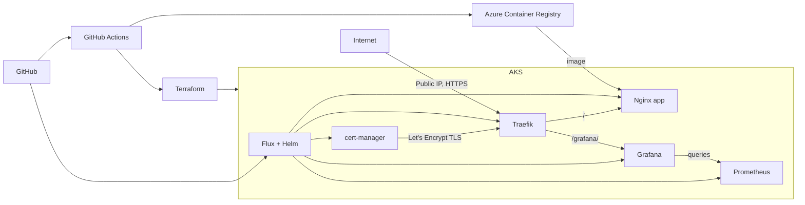

# DevOps Lab

Ephemeral Azure AKS lab with GitOps and HTTPS.



```text
app/        Nginx application
charts/     Application Helm chart
clusters/   Flux manifests and monitoring
terraform/  Azure infrastructure and Flux bootstrap
.github/    CI and Terraform workflows
```

Prometheus is internal. Monitoring uses temporary `emptyDir` storage.

[Detailed lab guide](DEVOPS_EPHEMERAL_LAB.md)
